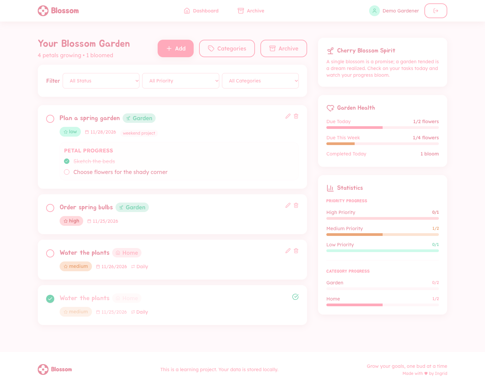

# Blossom Task Manager 🌸

Blossom is a cherry blossom-themed task manager for organizing personal work and tracking progress. It pairs a React dashboard with an Express API and a PostgreSQL database.



## Try the workflow

1. Create **Water the plants**, choose a due date, and set **Repeat** to **Weekly**.
2. Complete it on the dashboard. Blossom keeps the completed task and adds a new occurrence due one week after the original due date.
3. Archive completed tasks to clear the dashboard, then restore one from the archive to work on it again.

You can also break tasks into subtasks, organize them with categories and tags, and filter by status, priority, or category. Accounts use JWT access tokens with automatic refresh, and the API scopes tasks and categories to the signed-in user.

## Engineering decisions

- **Generate recurring tasks in the completion transaction.** Blossom locks the occurrence before changing its status and writes the next occurrence in the same transaction. PostgreSQL uniqueness constraints prevent duplicate successors when requests retry or arrive concurrently. The new task inherits the repeat rule and its subtasks start unchecked. [Recurrence service](backend/src/services/taskRecurrence.js) · [Database constraints](backend/prisma/migrations/20261125113000_add_recurring_task_series/migration.sql)
- **Model completion time separately from edit time.** A PostgreSQL trigger sets `completedAt` on completion, preserves it through edits and archiving, and clears it when a task returns to pending. The dashboard counts completions in the viewer’s local day and treats due dates as calendar dates. Older tasks with unknown completion times stay out of the daily count until completed again. [Completion migration](backend/prisma/migrations/20261125110000_add_task_completed_at/migration.sql) · [Date calculations](frontend/src/utils/taskDateStats.js)

## Run locally

You’ll need Node.js 22.12 or newer, npm, and a running PostgreSQL 14 or newer instance.

```bash
git clone https://github.com/innthegrid/blossom-task-manager.git
cd blossom-task-manager
createdb blossom_db
cd backend
cp .env.example .env
node -p "require('node:crypto').randomBytes(32).toString('hex')"
```

In `backend/.env`, set `JWT_SECRET` to the generated value. Replace `YOUR_POSTGRES_USER` in `DATABASE_URL` with your PostgreSQL username and add a password if your database requires one.

```bash
npm ci
npm run generate
npx prisma migrate deploy
npm run dev
```

From the repository root in a second terminal:

```bash
cd frontend
cp .env.example .env
npm ci
npm run dev
```

Open [http://localhost:5173](http://localhost:5173) and register an account. The API defaults to port 5001.

### Optional sample data

Set `DEMO_PASSWORD` in `backend/.env` to a password with at least six characters, one uppercase letter, and one digit. Run `npm run seed` from `backend/`, then sign in as `blossom@example.com` with that password. To use a different address, set `DEMO_EMAIL`. Rerunning the command preserves existing accounts, passwords, and task edits.

## Tests and CI

GitHub Actions runs frontend lint, tests, and the production build. The API integration suite runs against PostgreSQL and covers session refresh, account isolation, the task lifecycle, safe seeding, and concurrent recurring-task completion. [CI workflow](.github/workflows/ci.yml)

Run `npm run lint`, `npm test`, and `npm run build` from `frontend/`. For the API suite, use a dedicated PostgreSQL test database and follow the [integration test setup](backend/scripts/README.md#automated-api-integration-tests).

## Hosting configuration

| Where | Variable | Value |
| --- | --- | --- |
| API runtime | `DATABASE_URL` | PostgreSQL connection string |
| API runtime | `JWT_SECRET` | Private, randomly generated signing secret |
| API runtime | `FRONTEND_ORIGIN` | Frontend origin, such as `https://blossom.example.com` |
| API runtime | `PORT` | Port assigned by the host, or `5001` |
| Frontend build | `VITE_API_BASE_URL` | Public API URL ending in `/api` |

Run `npx prisma migrate deploy` before starting the hosted API. Set the frontend URL before `npm run build` and configure the static host to serve `index.html` for client-side routes.

## License

[MIT](LICENSE) · Built by Ingrid Tsai
